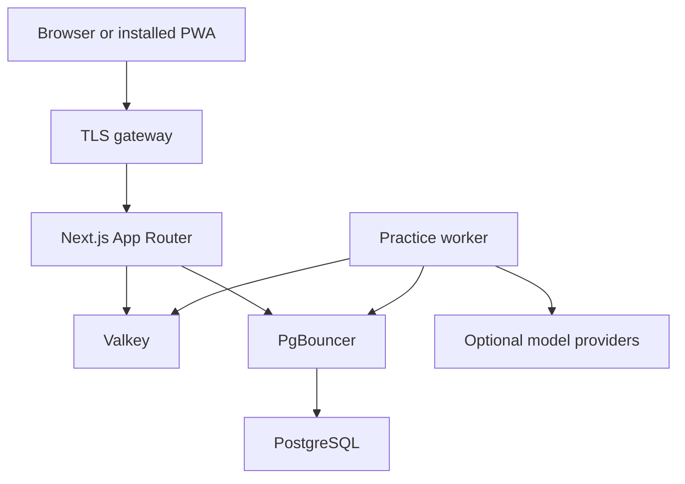

# CogniCare

CogniCare is a TypeScript progressive web app for short cognitive activities, daily reminders, and consent-based caregiver monitoring. The intended pilot serves older adults living with memory difficulties, including people with dementia, and their care partners in the United States. It targets phones, tablets, desktops, and intermittent connectivity.

The pilot measures activity and engagement. Clinical claims and the use of production patient data depend on the validation in [#21](https://github.com/OzPol/CogniCare/issues/21).

## Local development

Use Node.js 22.12 or later. Guest mode requires no service credentials.

```bash
npm ci
npm run dev
```

The app listens at [http://localhost:3000](http://localhost:3000).

For account flows, start Docker with Compose v2 and initialize the services before starting Next.js.

```bash
npm run setup
npm run dev
```

Setup starts PostgreSQL, PgBouncer, and Valkey. It applies Prisma migrations over the direct database connection, grants the runtime role access, and seeds synthetic accounts. It writes generated local secrets to `.env`.

| Account | Email | Password variable |
| --- | --- | --- |
| Player | `player@example.test` | `DEV_PLAYER_PASSWORD` |
| Caregiver | `care@example.test` | `DEV_CARE_PASSWORD` |

The first sign-in requires authenticator enrollment. Scan the QR code or enter the setup key, submit a six-digit code, and save the one-use recovery codes. For the caregiver flow, create an invitation in **Care circle** as the player and redeem it as the caregiver in a separate browser profile.

Practice suggestions use a separate worker. Run `npm run worker` with `PRACTICE_PLANS=true`. The built-in connector provides plans when external providers are unset.

For production-mode development checks, run `npm run build` and `npm start`. Home-screen installation on a physical phone or tablet requires an HTTPS origin. The public activity shell can reopen offline after its first online load. Signed-in players can opt into storing pending rounds under **My account**. Queued rounds expire after two days and use idempotency keys and verified account binding on reconnect.

## User stories

| Actor | Story | Issue |
| --- | --- | --- |
| Player | I want a clear home screen, large controls, and keyboard navigation so I can use the app independently. | [#3](https://github.com/OzPol/CogniCare/issues/3) |
| Player | I want to find matching cards at my own pace so I can practice memory. | [#4](https://github.com/OzPol/CogniCare/issues/4) |
| Player | I want to choose the picture that matches a prompt so I can practice attention. | [#5](https://github.com/OzPol/CogniCare/issues/5) |
| Player | I want to recall the next step of an everyday task so I can practice familiar routines. | [#6](https://github.com/OzPol/CogniCare/issues/6) |
| Player | I want to complete a visual sequence so I can practice pattern and object recognition. | [#7](https://github.com/OzPol/CogniCare/issues/7) |
| Player | I want difficulty to reflect my recent performance and a manual choice when I prefer. | [#8](https://github.com/OzPol/CogniCare/issues/8) |
| Player | I want instructions and choices in a language I use, with the option to hear them. | [#9](https://github.com/OzPol/CogniCare/issues/9) |
| Account holder | I want to sign in with an existing provider and confirm my identity before viewing records. | [#10](https://github.com/OzPol/CogniCare/issues/10), [#18](https://github.com/OzPol/CogniCare/issues/18) |
| Player | I want to schedule and complete medicine, hydration, activity, and appointment reminders. | [#11](https://github.com/OzPol/CogniCare/issues/11) |
| Player | I want to decide who can see my activity and overdue reminders, and revoke that access. | [#12](https://github.com/OzPol/CogniCare/issues/12) |
| Caregiver or healthcare worker | I want to see activity, engagement, and overdue reminders for people who have shared access. | [#12](https://github.com/OzPol/CogniCare/issues/12) |
| Player | I want to open the app with intermittent service and sync rounds when connected again. | [#13](https://github.com/OzPol/CogniCare/issues/13), [#22](https://github.com/OzPol/CogniCare/issues/22), [#24](https://github.com/OzPol/CogniCare/issues/24) |
| Caregiver | I want short practice suggestions even during a provider outage. | [#16](https://github.com/OzPol/CogniCare/issues/16) |
| Operator | I want concurrent updates, retries, and bursts to preserve consistency and predictable response behavior. | [#14](https://github.com/OzPol/CogniCare/issues/14), [#15](https://github.com/OzPol/CogniCare/issues/15), [#25](https://github.com/OzPol/CogniCare/issues/25) |
| Maintainer | I want reproducible setup, reviewable changes, and automated verification. | [#1](https://github.com/OzPol/CogniCare/issues/1), [#2](https://github.com/OzPol/CogniCare/issues/2), [#17](https://github.com/OzPol/CogniCare/issues/17) |

## Requirements and verification

| Area | Requirement | Pilot implementation and evidence |
| --- | --- | --- |
| Cognitive activities | Exercise memory, attention, routine recall, pattern recognition, and engagement. Use familiar imagery, objects, and routines. | Four untimed activities. Rounds were exercised in Chromium. [#4](https://github.com/OzPol/CogniCare/issues/4) through [#7](https://github.com/OzPol/CogniCare/issues/7) track the individual games. |
| Adaptive difficulty | Adjust difficulty to performance and account for the player’s support needs. Keep manual controls. | An online logistic skill model adjusts the per-activity suggestion. Guests adapt within a visit. Signed-in rounds persist with daily aggregates. Condition-specific inputs and their validation are tracked in [#21](https://github.com/OzPol/CogniCare/issues/21). |
| Language and voice | Support multilingual navigation and activities with spoken instructions and culturally familiar content. | English and Spanish, recognizable illustrations, and local device speech synthesis. Expanded language, imagery, and audio coverage is tracked in [#23](https://github.com/OzPol/CogniCare/issues/23). |
| Reminders and alerts | Schedule medicine, hydration, daily activity, and appointment reminders. Surface overdue items to authorized viewers. | **Today** supports editing, completion, reopening, and soft removal. Home shows a due notice while online. The caregiver dashboard shows overdue items. Background delivery is tracked in [#20](https://github.com/OzPol/CogniCare/issues/20). |
| Care monitoring | Track activity and performance to support caregiver and healthcare-worker review. Require consent per relationship. | Single-use invitations expire after 24 hours. Revocation blocks subsequent reads. The dashboard shows recent activity, daily counts, per-game scores, and overdue reminders. Care authorization is integration-tested. Daily aggregates use UTC. |
| Mobile and offline | Support simple phone and tablet use with offline play and sync. | A responsive PWA caches its public shell and assets. IndexedDB writes are opt-in, scoped to the verified account, and retried with the same key. Offline reload and reconnect sync were exercised in Chromium. Device verification is in [#22](https://github.com/OzPol/CogniCare/issues/22). Offline reminder storage is in [#24](https://github.com/OzPol/CogniCare/issues/24). |
| Accessibility | Target WCAG 2.1 AA with native controls, keyboard access, focus indicators, readable contrast, touch targets, and announced updates and rollbacks. | Large-print mode, semantic controls, a skip link, and live regions are in place. Formal criterion-by-criterion and screen-reader verification is tracked in [#19](https://github.com/OzPol/CogniCare/issues/19). |
| High concurrency | Keep compute stateless. Cache public reads at the edge and in Redis-compatible storage. Coalesce repeated reads, limit per user and IP, and apply backpressure to bursty work. | App Router handlers use shared PostgreSQL and Valkey state. The public catalog sends CDN cache directives and uses process-local coalescing plus a distributed cache lease. A cold-cache test with 1,000 callers and two readers recorded one PostgreSQL read. The gateway example implements IP limits. API boundaries enforce shared user and IP budgets. Deployment load and failure tests are in [#25](https://github.com/OzPol/CogniCare/issues/25). |
| Concurrent writes | Require idempotency keys on domain mutations, reject stale versions with HTTP 409, and protect contended rows with atomic predicates or locks. | PostgreSQL transactions include scoped mutation receipts and audits. Optimistic reminder writes use a version predicate. Round progression and invitation redemption serialize contended changes. Integration tests exercise duplicate writes, changed payloads, and competing edits. |
| Database design | Use PostgreSQL and typed queries, composite and partial indexes, keyset paging, pooled runtime access, and projections for heavy reads. | Prisma provides the schema and typed queries. SQL migrations add filtered reminder indexes. Reminder lists use `(dueAt, id)`. Care queries batch lookups and use transactionally maintained daily aggregates. PgBouncer serves runtime traffic. Prisma Migrate connects directly. |
| AI integration | Use typed provider adapters, model routing and fallback, schema validation, bounded cost and latency, SSE, async execution, and circuit breakers. | The practice connector accepts a fixed template enum and validates two game IDs with Zod. It caps calls, tokens, bytes, and elapsed time. Jobs use queue limits, leases, and retry caps. SSE sends job state and results. A built-in plan covers unavailable providers. |
| Security | Enforce authentication and RBAC/ABAC at protected boundaries. Use schema validation, parameterized SQL, strict CSP, secure cookies, server-side secrets, and least-privilege service credentials. | Domain handlers check database session MFA and the caller’s role and relationships. Inputs use strict Zod schemas and queries use Prisma or bound SQL. HTTPS service cookies use `HttpOnly`, `Secure`, and `SameSite=Lax`. Local seed credentials are for loopback development. Live OAuth callback evidence is tracked in [#18](https://github.com/OzPol/CogniCare/issues/18). |
| Change control and reliability | Audit state changes, use versioned migrations and rollback plans, support soft deletes and flags, and emit correlation IDs, readiness, and structured logs. | Domain mutations record redacted before/after values with the actor, entity, timestamp, and correlation ID. PostgreSQL guards audit rows against update, delete, and truncate. The practice worker is feature-flagged. GitHub Actions runs the build and test suite. |

## Runtime architecture



The service worker caches the public document and versioned assets. Protected API responses use `private, no-store`. Any future Server Action must enforce the same authentication, origin, authorization, and input checks as the route handlers.

The background queue accepts at most 100 pending or running jobs and three per user. Claims use `FOR UPDATE SKIP LOCKED`. The worker receives a fixed practice-style enum, with no patient identifiers or reminder content.

## Operations

- Set `COGNICARE_MODE=service` and `APP_ORIGIN` to the HTTPS origin. Generate distinct 32-byte hex values for `AUTH_SECRET` and `MFA_KEY`. Use a scoped runtime role, a separate direct migration credential, and TLS for database and cache connections that cross hosts.
- Configure only the OAuth providers the deployment uses. Register `https://your-host/api/auth/callback/google`, `/api/auth/callback/microsoft`, or `/api/auth/callback/github` against that origin. Set `MICROSOFT_TENANT_ID` for the appropriate tenant. The provider-specific variables are in `.env.example`.
- Assign care roles from an authorized operator session with the direct database credential. Use `ROLE_ADMIN_ID=operator-id npm run care:role -- user@example.org CAREGIVER` or `HEALTH_WORKER`. Assignment revokes existing sessions. The player still grants each care relationship.
- Bind Next.js to a private listener. [ops/nginx.example.conf](ops/nginx.example.conf) overwrites the client IP header, rate-limits ingress, and leaves SSE unbuffered. Configure trusted CDN forwarding ranges at the gateway. Restrict shared caching to the public catalog and static assets.
- Apply checked-in SQL with `npm run db:deploy` against the direct URL. Take a pre-release snapshot and rehearse restore. The baseline rolls back by snapshot restore. Subsequent rollback SQL is under [prisma/rollback](prisma/rollback). Reconcile Prisma migration history as part of the rollback.
- Use `/api/health` for liveness and `/api/ready` for dependency readiness. Request logs and domain audit records share correlation IDs. Review access, retention, backup, and incident handling as part of [#21](https://github.com/OzPol/CogniCare/issues/21).
- Use a named feature branch and one coherent change per commit. Reference the matching issue in the commit message. Keep credentials, real records, and local service state out of Git.

## Verification

```bash
npm run lint
npm run typecheck
npm test
npm run build
```

With fresh sample accounts and a running app, use `npm run test:integration`. Start the worker when `PRACTICE_PLANS=true`. The suite covers required MFA, one-use recovery, care permissions, mutation receipts, conflicting reminder patches, cache coalescing, queue execution, and append-only audit permissions. [The CI workflow](.github/workflows/ci.yml) starts the services and runs these checks on pushes and pull requests.
